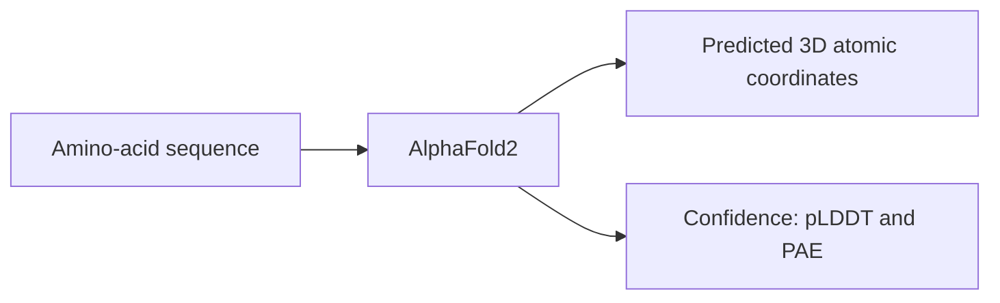

# Protein-sequence, visual and tool examples

**The current strengths are biological figure/table QA.** Protein sequence examples below are correct individual predictions from a weak overall run.

## Does our Qwen model support images?

**Yes. Our exact Qwen/Qwen3.8-27B BF16 checkpoint has a vision encoder and was run with actual image inputs.** FigQA supplied 181 images across 181 cases; TableQA supplied 262 images across 244 cases. These are multimodal evaluations of the same checkpoint, not calls to a separate OCR or image model. [Local capability evidence](QWEN_VISION_CAPABILITY.json) · [Official model card](https://huggingface.co/Qwen/Qwen3.8-27B)

## Why a vision-language model appears on LitQA2

LitQA2 supplies text questions and choices; no image is supplied in our run. A vision-language model can also answer text-only questions. Ryze uses Qwen3-VL-8B as its base model and evaluates across LAB-Bench's text and visual categories, including FigQA and TableQA. [Ryze paper](https://arxiv.org/html/2606.00902v1)

## Actual protein-sequence predictions

Task P03 asks for a protein's subcellular location from its complete amino-acid sequence and the ten-class label list. No images, structures, organism labels, external tools or reference labels were sent. Our prompted Qwen baseline scored **724/2,773 = 26.1%** overall; it does not match a task-trained specialist. These three examples were selected for correctness and short length, and are not representative of the full run. Mechanistic explanations remain unassessed.

### `subcellular_localization:test:84` — 75 amino acids

Complete supplied sequence:

```text
MSQQQGYYQQGPPQQGYYQQGPPQQGYYQQGPPQQGYPQQQPVYVQQGQPKEESCLDSCLKCLCCCFLLELVCDN
```

Saved answer: **`0` — Cell membrane**. Native reference: **Cell membrane**. Correct.

### `subcellular_localization:test:439` — 56 amino acids

Complete supplied sequence:

```text
MAHENVWFSHPRRYGKGSRQCRVCSSHTGLIRKYGLNICRQCFREKANDIGFNKFR
```

Saved answer: **`1` — Cytoplasm**. Native reference: **Cytoplasm**. Correct.

### `subcellular_localization:test:1725` — 106 amino acids

Complete supplied sequence:

```text
MEFDLGAALEPTSQKPGVGAGHGGDPKLSPHKVQGRSEAGAGPGPKQGHHSSSDSSSSSSDSDTDVKSHAAGSKQHESIPGKAKKPKVKKKEKGKKEKGKKKEAPH
```

Saved answer: **`6` — Nucleus**. Native reference: **Nucleus**. Correct.

Full saved requests/responses, native labels and source hashes: [protein sequence records](EXAMPLES_PROTEIN_SEQUENCES.json).

## Actual visual questions and correct answers

The supplied images are reproduced unchanged from the approved public LAB-Bench requests. [Source dataset](https://huggingface.co/datasets/futurehouse/lab-bench). Both examples ended normally and match the native reference choices.

### B04: Biological figure: oligodendrocyte sheath lengths


[Original benchmark figure](https://github.com/Future-House/LAB-Bench/blob/998a8e0a40cf116c80e1b0e7a805ebb5fb9fa838/FigQA/figs/088.jpg); paper DOI: [10.1016/j.cub.2015.07.056](https://doi.org/10.1016/j.cub.2015.07.056).

```text
In panel e, which of the following sheath lengths do cortex oligodendrocytes produce at the highest frequency?

Options:
(A) Insufficient information to answer the question
(B) 10
(C) 30
(D) 20
(E) 5
(F) 15
```

Saved answer and native reference: **D — 20 µm**.

Saved final response:

> Looking at panel **e** (Cerebellar slice culture), the teal bars represent cortex oligodendrocytes. The tallest cortex bar occurs at the 20 µm bin (≈20% frequency), with neighboring bins (10–15 µm and 30 µm) being lower. This is consistent with the fitted peak in panel f at a log length of ~1.2–1.3 (≈15–20 µm).
>
> Therefore, the sheath length produced at the highest frequency by cortex oligodendrocytes is **20 µm**.
>
> [ANSWER]D[/ANSWER]

### B05: Scientific table: force-field errors


[Original benchmark table](https://github.com/Future-House/LAB-Bench/blob/998a8e0a40cf116c80e1b0e7a805ebb5fb9fa838/TableQA/tables/153.png); paper DOI: [10.1021/acs.jctc.1c00302](https://doi.org/10.1021/acs.jctc.1c00302).

```text
Which model shows the lowest MSE when chi1 = 300?

Options:
(A) OPLS4a
(B) OPLS3e
(C) Both OPLS4a and OPLS3e have the same lowest value for MSE when chi1 = 300
(D) Insufficient information to answer the question
(E) OPLS4
```

Saved answer and native reference: **E — OPLS4 (+0.2 ± 0.2 in the requested column)**.

Saved final response:

> Looking at the "MSE (chi1 = 300)" column:
> - OPLS3e: +0.5 ± 0.2
> - OPLS4a: +0.5 ± 0.2
> - OPLS4: +0.2 ± 0.2
>
> The lowest value is +0.2, corresponding to OPLS4.
>
> [ANSWER]E[/ANSWER]

Aggregate scores: **FigQA 131/181 = 72.4%**, **TableQA 215/244 = 88.1%**. These public-run scores use native supplied images and a fixed Qwen run; paper protocols and subsets may differ. [Saved visual records and hashes](EXAMPLES_VISION.json).

## External models actually used in the papers

[Published tool-use examples](PUBLISHED_TOOL_USE_EXAMPLES.md) records concrete AlphaFold2, ESMFold and OmegaFold computations and the resulting published metrics. These are source-paper results; our Qwen runs have not reproduced those tool-based protocols.

## What AlphaFold does

AlphaFold2 predicts a protein's 3D atomic coordinates from its amino-acid sequence. Its normal pipeline also obtains a multiple-sequence alignment from related sequences and may use structural templates. It returns a structure file (PDB/mmCIF), local confidence (pLDDT), and uncertainty in relative placement of regions (PAE). [EMBL-EBI explanation](https://www.ebi.ac.uk/training/online/courses/alphafold/inputs-and-outputs/alphafold-inputs-and-outputs-recap/)



pLDDT measures local structural confidence, not experimental stability, solubility, affinity or function. [Confidence interpretation](https://www.ebi.ac.uk/training/online/courses/alphafold/inputs-and-outputs/evaluating-alphafolds-predicted-structures-using-confidence-scores/plddt-understanding-local-confidence/)

For **concrete results actually computed with external models in the papers**, see [Published tool-use examples](PUBLISHED_TOOL_USE_EXAMPLES.md). This separates evaluator model calls from autonomous tool use by an LLM.
